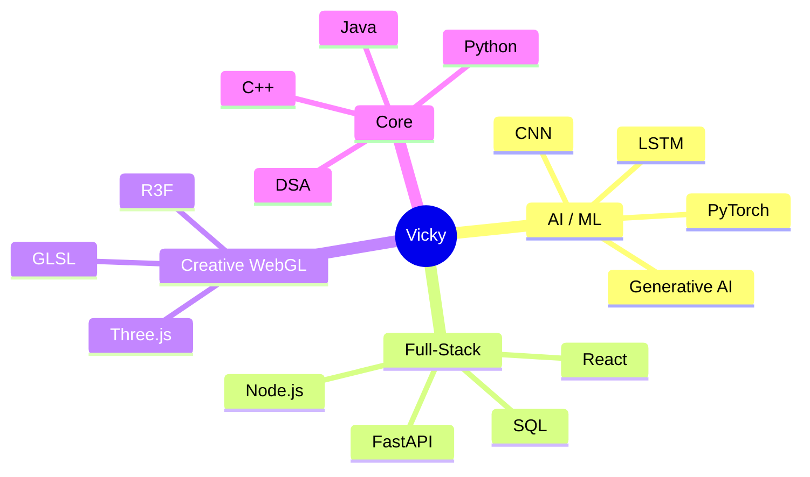
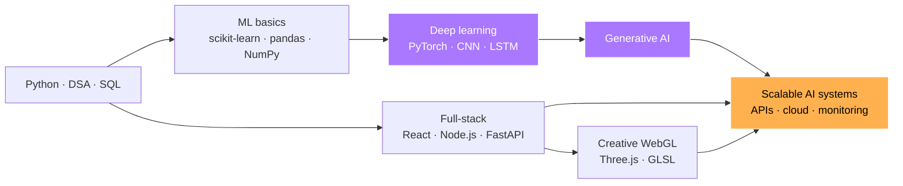

<!-- Profile README for github.com/Vicky-45-11/Vicky-45-11 -->

<a id="top"></a>

<div align="center">


<a href="https://github.com/Vicky-45-11">

</a>

<br/>


<br/><br/>

<!-- quick-jump menu -->
<a href="#player"></a>
<a href="#classes"></a>
<a href="#quests"></a>
<a href="#inventory"></a>
<a href="#snake"></a>
<a href="#connect"></a>

</div>

---

<a id="player"></a>
## `> whoami`

```ts
const vicky = {
  name: "Vigneshwaran S G",
  handle: "Vicky-45-11",
  focus: ["AI / ML", "Full-Stack", "Creative WebGL"],
  currentlyBuilding: "AI/ML and full-stack projects",
  currentlyLearning: ["PyTorch", "LSTM", "CNN", "Generative AI", "Scalable AI systems"],
  lookingToCollaborateOn: ["AI", "Machine Learning", "Innovative software projects"],
  lookingForHelpWith: ["Advanced Deep Learning", "Real-world AI applications"],
  askMeAbout: ["Python", "Java", "C++", "DSA", "SQL", "AI/ML", "React", "Node.js", "Git"],
  funFact: "The best way to learn technology is by building projects with it.",
} as const;
```

### 🎮 Player card

```text
╔══════════════════════════════════════════════╗
║  PLAYER   : Vicky-45-11                      ║
║  CLASS    : AI Engineer / WebGL Wizard       ║
║  STATUS   : 🟢 online, building something    ║
╠══════════════════════════════════════════════╣
║  AI / ML      ████████████░░░░░░░░  LEARNING ║
║  FULL-STACK   ██████████████░░░░░░  SOLID    ║
║  WEBGL / 3D   ███████████████░░░░░  FAVOURITE║
║  DSA          █████████████░░░░░░░  DAILY    ║
╠══════════════════════════════════════════════╣
║  QUEST    : PyTorch → LSTM → CNN → GenAI     ║
║  LOOT     : projects shipped, bugs squashed  ║
╚══════════════════════════════════════════════╝
```

<table>
<tr>
<td width="50%" valign="top">

### 🚀 Working on
AI/ML and full-stack projects, from voice and civic-tech apps to immersive 3D sites.

### 🌱 Learning
PyTorch · LSTM · CNN · Generative AI · scalable AI systems

</td>
<td width="50%" valign="top">

### 🤝 Let's collaborate
AI, machine learning and innovative software projects.

### 🛠️ Need a hand with
Advanced deep learning and real-world AI applications.

</td>
</tr>
</table>

<p align="right"><a href="#top">⬆ back to top</a></p>

---

<a id="classes"></a>
## 🧙 Pick a class

> Click a class to expand it.

<details>
<summary><b>🧠 AI / ML Engineer</b></summary>
<br/>

**Skills:** PyTorch · TensorFlow · Keras · scikit-learn · Pandas · NumPy
**Currently levelling up:** LSTM, CNN, Generative AI
**Proof of work:** [CivicLens AI](https://github.com/Vicky-45-11/civiclens-ai), a PyTorch image classifier with duplicate detection for civic issue reports.

</details>

<details>
<summary><b>⚙️ Full-Stack Developer</b></summary>
<br/>

**Skills:** React · Next.js · Node.js · Express · FastAPI · PostgreSQL · Supabase
**Currently levelling up:** scalable APIs, cloud deploys, monitoring
**Proof of work:** [Murmur](https://github.com/Vicky-45-11/murmur-voice-site) and [SecondLife AI](https://github.com/Vicky-45-11/secondlife-ai).

</details>

<details>
<summary><b>🌌 Creative WebGL Wizard</b></summary>
<br/>

**Skills:** Three.js · React Three Fiber · GLSL · GSAP · Framer Motion
**Currently levelling up:** custom shaders and procedural geometry
**Proof of work:** [GeoVerse](https://github.com/Vicky-45-11/geoverse) and [M340i Atelier](https://github.com/Vicky-45-11/m340i-atelier).

</details>

<p align="right"><a href="#top">⬆ back to top</a></p>

---

<a id="quests"></a>
## 🛰️ Featured builds (quest board)

<div align="center">

<table>
<tr>
<td width="50%" align="center" valign="top">
<a href="https://github.com/Vicky-45-11/geoverse"></a><br/>
 
</td>
<td width="50%" align="center" valign="top">
<a href="https://github.com/Vicky-45-11/m340i-atelier"></a><br/>
 
</td>
</tr>
<tr>
<td width="50%" align="center" valign="top">
<a href="https://github.com/Vicky-45-11/civiclens-ai"></a><br/>
 
</td>
<td width="50%" align="center" valign="top">
<a href="https://github.com/Vicky-45-11/murmur-voice-site"></a><br/>
 
</td>
</tr>
<tr>
<td width="50%" align="center" valign="top">
<a href="https://github.com/Vicky-45-11/secondlife-ai"></a><br/>
 
</td>
<td width="50%" align="center" valign="top">
<a href="https://github.com/Vicky-45-11/vigneshwaran-portfolio"></a><br/>
 
</td>
</tr>
</table>

<br/>

<a href="https://github.com/Vicky-45-11?tab=repositories"></a>

</div>

<br/>

<details>
<summary><b>📜 Read the quest log</b> (what each build does)</summary>
<br/>

| Project | What it is | Stack |
| :-- | :-- | :-- |
| 🌍 [**GeoVerse**](https://github.com/Vicky-45-11/geoverse) | A real-time 3D Earth with a place explorer, three worlds and an Object Lab, driven by custom GLSL shaders | React · Three.js · R3F · TypeScript |
| 🚗 [**M340i Atelier**](https://github.com/Vicky-45-11/m340i-atelier) | A cinematic 3D car showroom and configurator built from procedural geometry | React · Three.js · R3F · Zustand |
| 🏙️ [**CivicLens AI**](https://github.com/Vicky-45-11/civiclens-ai) | Civic issue reporting: residents photograph and pin a problem, staff moderate, triage and resolve it with photo evidence, plus a PyTorch image classifier and duplicate detection | FastAPI · PostGIS · PyTorch · Next.js |
| 🎙️ [**Murmur**](https://github.com/Vicky-45-11/murmur-voice-site) | A voice-dictation product site with a live demo and a typing speed test | React · Web Speech |
| 🧠 [**SecondLife AI**](https://github.com/Vicky-45-11/secondlife-ai) | An e-waste awareness site that helps people give old devices a second life, with a labelled demo analysis flow | Next.js · React · Three.js · GSAP |
| 💼 [**Portfolio**](https://github.com/Vicky-45-11/vigneshwaran-portfolio) | My portfolio as a block world you dig through: sky, caves, lava and a final dimension, with a hotbar, XP bar, weather and a project crafting table | React · TypeScript · Tailwind · Framer Motion |

</details>

<p align="right"><a href="#top">⬆ back to top</a></p>

---

<a id="inventory"></a>
## 🧰 Inventory (tech arsenal)

<details open>
<summary><b>🎒 Open / close the backpack</b></summary>
<br/>

<div align="center">

**Languages**<br/>


**Frontend & 3D**<br/>


**Backend & APIs**<br/>


**AI / ML**<br/>
<br/>
  

**Cloud, DevOps & Monitoring**<br/>


**Data**<br/>
<br/>


**Design, 3D & Motion**<br/>


**Hardware & Systems**<br/>


</div>

</details>

<details>
<summary><b>More tools I've worked with</b> (click to expand)</summary>
<br/>


</details>

<p align="right"><a href="#top">⬆ back to top</a></p>

---

## 🧬 Skill map



## 🗺️ Learning roadmap



> The highlighted nodes are what I'm learning right now.

### ✅ Side quests

- [x] Ship a 3D showroom with procedural geometry
- [x] Build a civic-tech app with an image classifier
- [x] Turn my portfolio into a block world
- [ ] Master LSTM and CNN in PyTorch
- [ ] Ship a Generative AI project
- [ ] Deploy an AI system with monitoring

<p align="right"><a href="#top">⬆ back to top</a></p>

---

## 📊 GitHub stats

<div align="center">


<br/>


<br/><br/>


</div>

<p align="right"><a href="#top">⬆ back to top</a></p>

---


<a id="snake"></a>
## 🐍 Feed the snake

<div align="center">
  <picture>
    <source
      media="(prefers-color-scheme: dark)"
      srcset="https://raw.githubusercontent.com/Vicky-45-11/Vicky-45-11/output/github-snake-dark.svg"
    />
    <source
      media="(prefers-color-scheme: light)"
      srcset="https://raw.githubusercontent.com/Vicky-45-11/Vicky-45-11/output/github-snake.svg"
    />
    
  </picture>
  <sub>Every commit I make is food for the snake. Keep it hungry.</sub>
</div>

---

<a id="connect"></a>
## 🌐 Let's connect

<div align="center">

[](mailto:vs1130@srmist.edu.in)
[](https://linkedin.com/in/YOUR-LINKEDIN-SLUG)
[](https://instagram.com/_.vicky_45)
[](https://pinterest.com/VICKY)
[](https://github.com/Vicky-45-11/vigneshwaran-portfolio)

<br/>

### 😄 Dev joke (refresh the page for a new one)


<br/>

💬 **Ask me about** Python · Java · C++ · DSA · SQL · AI/ML · React · Node.js · Git

⚡ *"The best way to learn technology is by building projects with it."*


</div>
